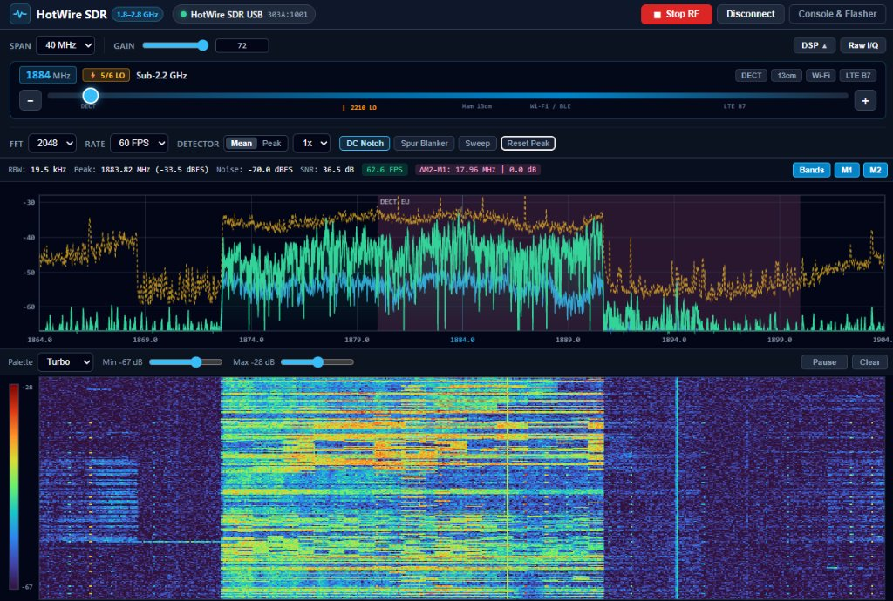

# HotWire SDR — 1.84–2.79 GHz RF Spectrum Analyzer

A zero-install **Progressive Web App (PWA)** and dual-core **ESP32-S3 firmware** providing a real-time **1.84–2.79 GHz RF Spectrum Analyzer**, **scrolling Waterfall**, **Raw Baseband I/Q Constellation Inspector**, **xterm.js Serial Terminal**, and in-browser **`esptool-js` Web Flasher** for the **Seeed Studio XIAO ESP32-S3**.

**Live Web App (GitHub Pages):** https://kavierim.github.io/HotWire-SDR/



## HotWire Ecosystem

- **[HotWire SDR](https://github.com/kavierim/HotWire-SDR)** ([Live App](https://kavierim.github.io/HotWire-SDR/)) — 1.84–2.79 GHz RF Spectrum Analyzer & Waterfall for XIAO ESP32-S3
- **[HotWire Logic Analyzer](https://github.com/kavierim/HotWire-Logic-Analyzer)** ([Live App](https://kavierim.github.io/HotWire-Logic-Analyzer/)) — 8-Channel Logic Analyzer & Tri-State Force I/O with UART/SPI/I²C decoders
- **[HotWire Serial Terminal](https://github.com/kavierim/HotWire-Serial-Terminal)** ([Live App](https://kavierim.github.io/HotWire-Serial-Terminal/)) — Cross-platform Web Serial & WebUSB terminal for desktop and Android

## Features

- **1.84–2.79 GHz Wideband RF Receiver (`ESP32-S3 RF Dump Engine`):**
  - Direct capture via ESP32-S3 SRAM arbiter (`0x3FCD0000–0x3FCDFFFF`) reserved at boot with `SOC_RESERVE_MEMORY_REGION`.
  - Continuous RFPLL tuning (`2210–2790 MHz` direct VCO, plus `1842–2209 MHz` via `5/6` LO divider in I2C block `0x63`).
  - Selectable span (`40 MHz` default matching the hardware analog baseband LPF, plus `80`, `20`, and `16 MHz`), analog baseband RX filter control (`0x67`), and manual RX gain (`0–72`) with real-time `ADC CLIP` alerting.
- **Full-Width Tuner & Dual-Canvas High-DPI RF Plotter:**
  - Full-width frequency slider with `−`/`+` step buttons (`±1 MHz`, `Shift` for `±10 MHz`) and one-tap band pills (`DECT`, `13cm`, `Wi-Fi`, `LTE B7`).
  - Live / Average / Peak-Hold spectrum traces with DECT EU, 13cm Ham, Wi-Fi, BLE, and LTE B7 band overlays, crosshair readout, and draggable `M1`/`M2` delta markers.
  - Scrolling heatmap waterfall with `Turbo`, `Viridis`, and `Inferno` colormaps and interactive `Min / Max dBFS` range sliders.
  - Host & hardware DSP options (`DSP` drawer): `FFT` (`256–2048`), `Rate` (`10–60 FPS`), `Mean` vs `Peak` detector, `DC Notch`, `Spur Blanker`, and `0x32` Wideband Sweep.
- **Raw Baseband I/Q Inspector (`0x85`):**
  - Captures single-shot or continuous signed 8-bit I/Q streams for time-domain envelope analysis and 2D constellation visualization.
- **Dedicated Dual-Core Firmware:**
  - Core 0 handles USB CDC binary protocol parsing and serial commands with zero blocking.
  - Core 1 runs dedicated RF Dump acquisition, Hann windowing, Radix-2 FFT, and high-FPS streaming.
- **Offline Demo Mode:**
  - Includes a built-in client-side RF spectrum and I/Q simulator (DECT 1.9 GHz, 13cm Ham, Wi-Fi, BLE, LTE B7) when no hardware is connected.

## Web Page Programming & Firmware Flashing

Flash the XIAO ESP32-S3 directly from Chromium (Chrome, Edge, Opera) via **Web Serial API** and **`esptool-js`**:

1. Connect the Seeed Studio XIAO ESP32-S3 via USB.
2. Open **Console & Flasher** at the bottom and switch to **Web Flasher (esptool-js)**.
3. Select **Seeed Studio XIAO ESP32-S3** and click **Flash Firmware** (or choose a custom `.bin`).

## Development & Verification

```bash
npm install
npm run typecheck
npm run lint
npm test
npm run build
```

## Firmware (`XIAO ESP32-S3`)

- Sketch: [`firmware/HotWire_SDR_XIAO_ESP32S3/HotWire_SDR_XIAO_ESP32S3.ino`](firmware/HotWire_SDR_XIAO_ESP32S3/HotWire_SDR_XIAO_ESP32S3.ino)
- FQBN: `esp32:esp32:XIAO_ESP32S3:USBMode=hwcdc,CDCOnBoot=default,PSRAM=opi`
- Compiled binaries are bundled in [`public/firmware/`](public/firmware/) for zero-install Web Flasher deployment.
